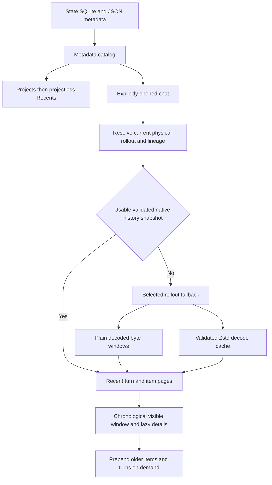

# Metadata catalog and progressive conversation rendering implementation plan

> **For agentic workers:** Implement this plan task by task using `subagent-driven-development` or `executing-plans`, preserve the interfaces and acceptance contracts below, and keep all Git mutations under the user's control

**Goal:** Display the complete local chat library from SQLite and JSON metadata, group actual projects above projectless Recents, and open conversations at their latest available turns with progressive history and readable native tool activity.  
**Architecture:** Separate the metadata catalog from conversation history and presentation. Read validated viewer-owned metadata snapshots first, resolve stable thread identity and physical rollout lineage, use native SQLite history pages when their lineage and watermarks are usable, and fall back to source-safe JSONL readers and viewer-owned Zstd decoding/indexing. Render chronological windows near the bottom, prepend older windows on demand, and prepare rich content only for visible or explicitly opened content.  
**Tech stack:** Existing Nuxt/Vue application, TypeScript, Node `node:sqlite` and `node:zlib`, the existing viewer cache, virtualizer, repository interfaces, Vitest and Playwright.  
**Spec:** The user's 2026-10-27 request and recompression lifecycle clarification, captured in the requirements and contracts in this single document. Execution began on 2026-10-27, implementation and review status is recorded below

## Execution checkpoint (end-of-day handoff 2026-10-29)

Checked items record implemented work with focused verification and independent task review, they do not certify the final integrated application. Tasks 1–10 are complete at that boundary. The user's commits `e8136e0` (Tasks 1–4) and `1707cba` (Tasks 5–7) contain prior reviewed work, Tasks 8–10 are in the working tree with new and moved source/test files. The user resumed on 2026-10-29, lifting the earlier end-of-day stop. Task 10's initial review and one scoped fix round closed all three Important final-answer findings (symmetric envelope proof, shared completion eligibility and preserved source phase/evidence), Task 11's implementation is frozen for the requested handoff with verification and independent review still open, Task 12 has not started, Task 2's remaining dependent-data/runtime integration checkbox stays open for the later shared gates  
Task 8 connects the metadata shell to bounded native/raw turn, item and partial navigator APIs, actual HTTP cancellation, one receiving-backend semantic-epoch authority, stable source-proved aliases and visible item gaps. Loaded content survives revalidation with explicit unresolved item/opening state, immutable rich formatting cannot establish source readiness, and Info consumes owned loaded snapshots without whole-session materialization. Native original/update byte coordinates remain separate from ordinals, unknown proof stays explicit  
The initial Task 8 review found three Important defects (disconnected Info controls, false first-ingestion island continuity, retained older payloads relabeled current after partial refresh). Fix round 1 closed those mechanisms, scoped re-review found one new bounded-opening recovery control gap, and fix round 2 closed it. All Task 8 Critical/Important findings are now closed. Final receipts include the amended 9-file/82-test covering run, 28 actual Nuxt HTTP tests with one real browser Info/invalidation case, final selection-owner checks, and the two-file opening-control regression with 6 tests. These overlap the original 16-file/127-test and 7-file/40-test gates and are not summed. Root/fixture typechecks and touched formatting/warning-free lint passed  
Task 9 supplies shared native/direct activity semantics, source-qualified outcomes, host-recorded attempted-call inventories and bounded parent approval evidence without inferring child success from orchestration code. Its initial review and two scoped fix rounds closed all Important findings, including full add/delete content in Markdown and logical review visibility through raw collection, normalized cache reuse, static export and retained windows. Parser contract 10 and viewer-cache schema 7 require fresh logical qualification, native adapter remains 4. The final scoped receipts include 204 affected Node tests, 16 cache tests, 13 Nuxt tests, 3 selected actual HTTP cases, 2 selected export/static-reader cases and 2 final raw-cutoff cases (overlapping scopes), root/fixture/test types, touched warning-free style and actual Jiti CLI help. No live host inventory sample, old immutable archive repair or final release acceptance is claimed  
Task 10 delivers shared disclosure defaults/intent, source-qualified final identity and order-symmetric presentation aliases, readable semantic work, lazy approval attempts and one selected child panel with observed identity. Its full review and scoped fix round closed all Important findings. Final fix receipts are 105 affected Node tests and 27 Nuxt tests, all affected types and seven-file warning-free style, these overlap the initial broader scoped receipts and are not summed. Parser 11, cache schema 7 and native adapter 4 are current. The retained old screenshot and 1 px height qualification belong to Task 11, old immutable archives and full/default/build/coverage/performance acceptance remain Task 12  
Task 11 is partially complete and unaccepted at handoff, its checkboxes remain open. The frozen implementation supplies measured progressive/static viewport behavior, retained-window/item limits and bounded rich work, final focused runs pass 37 Nuxt and 30 Node tests with touched style clean. Ten production-browser repetitions passed before the final consumed-range bookkeeping change, which has its own RED/GREEN regression and covering Nuxt run. The root content run passes two media/Mermaid cases and copy/responsive checks, but retains the original 676×691 versus 640×692 message screenshot mismatch, the 1 px height qualification and final-source production/resource acceptance remain open. The report also names pending item-request ownership on eviction, failure-cache pruning, giant-code/lifetime assertions and partial static-range/Inspector checks that must close within Task 11 before review. Frozen-source root and custom typechecks also passed in the controller's independent handoff receipt, fixture types passed as recorded. Continue this same Task 11 from its preserved 414-file baseline, close the named gates and perform its initial independent review before Task 12. The user requested handoff preparation after the remaining 40-minute work window, no Task 12 implementation starts today  
Task 12 now also includes the user's live/generated favicon repair and lazy OpenGraph hover request. Completed read-only research is in `link-preview-research.md` and `attachment-storage-research.md` under the SDD directory, with exact installed Desktop/package provenance and explicit limits. Current progressive favicon origin registration/scheduling is disconnected, historical generated-mode cause remains open. Plugin reports are under `.codex/state/plugins/codex-security`, attachments can be managed copies/original paths/inline bytes/cloud references, and displayed diffs can be persisted edits or recomputed live Git state. These findings inform supported reference/export parity, they do not expand into a standalone plugin/cloud/filesystem product  
The direct H3 dependency is removed. Task 8 migrates its required existing route/helper/test boundary to Nuxt's registered auto-imports, aliases, runtime tests and separate actual HTTP fixture. The user's Nuxt conventions and testing requirements apply to the whole repository, including existing code, Tasks 9–11 must follow them in touched code and Task 12 closes the remaining older-code cleanup and final import/test integration audit  
Earlier reviewed work preserves metadata-only startup/sidebar readiness, structural visibility and explicit project/Recents/Section identity, bounded qualified native snapshots, streaming Zstd and reverse raw history with safe cache ownership. Task 7's original five findings and cross-process live-reader reclamation correction remain closed for the exercised runtime. Preserve those contracts instead of restoring whole-session or full plain hashing before selected first paint  
Full/default tests, integrated performance/coverage/build/E2E, lossless versioned static writer/reader migration and final whole-plan review remain open. The early full-suite 521-pass/two-timeout/ENOTEMPTY result is not closed by focused runs. Carry Task 5 Minor N2 (retained native field freshness), Task 6 Minor M1 (point-lookup key admission), prior lint debt and the cache-owner journal header qualification into Task 12. The 512-byte guard is qualified on stock Windows Node 26.12.1, alternate VFS/PSOW compatibility needs qualification or bounded header-aware admission. The documentation inventory's modified/non-primary child-link behavior is closed by Task 10's reviewed actual browser coverage. Export acceptance stays fixture-backed or deliberately bounded, do not repeat the unaccepted historical full indexed archive workload  
Local reports, immutable task/fix diffs and the active ledger are in `.superpowers/sdd/2026-10-27-metadata-catalog-progressive-rendering/` (ignored scratch), durable resumption constraints are in `THOUGHTS.md`. Re-read HEAD/index before each task and preserve user commits before capturing a new baseline, never replay reviewed work or restore an old checkout. The final whole-plan review spans original base `0cbd840` through the eventual complete working tree including untracked files. Last checked HEAD is `1707cba` with an empty index, no Git mutations/worktrees or source Codex-home/Desktop writes were performed
## Global constraints

- Work locally and offline at runtime, bind live serving to loopback, and preserve static export
- Treat everything in the selected Codex home and installed Desktop package as read-only input, never launch an app-server to repair/materialize its state, run source migrations, checkpoint source WALs, create source SQLite sidecars, acquire application-owned write locks, or alter source timestamps
- Write snapshots, decoded streams, indexes and normalized/rich content only into viewer-owned storage, keep private research copies out of published artifacts
- Use only read-only Git commands, do not stage, unstage, commit, reset, branch, push or create worktrees
- Startup catalog readiness must not depend on rollout discovery, rollout `stat`, prefix reads, decompression, transcript normalization, history database materialization, rich rendering or favicon/media work
- A title, missing name, empty preview, transport source, model, cwd, or filename alone must not decide whether a row is a human chat, delegated child or internal review
- Keep stable thread ID, root session ID, physical rollout ID, item ID, turn ID, call ID, Code Mode cell ID, project ID and host identity separate
- Preserve missing/unsupported/stale data with provenance and diagnostics, never report unknown counters as zero or a partial transcript as complete
- Source filename equality is never proof of content equality, including after decompression, append and recompression
- Preserve existing sanitization, loopback checks, same-origin mutation checks and asset containment protections, no execution of recorded JavaScript, shell code, HTML or tool payloads
- Follow the user's source/Markdown conventions, keep logical lines unwrapped, and leave all Git ownership with the user
- Use Nuxt's registered auto-imports and project aliases in app/server code, keep shared API types under `shared/`, and use the official `@nuxt/test-utils` runtime and separate Node E2E environments for framework-dependent tests, remove the unnecessary direct H3 dependency as part of Task 8 integration

## Review focus

- A compressed session resumes and is recompressed at the same path with changed content, any old decoded file, page, projection association or pending worker result must be invalidated by generation/content evidence (Tasks 2, 6, 7 and 12)
- A paginated or reverted thread has several physical rollouts and a `history_base`, loading only the newest file or joining history rows directly on stable thread ID must not silently omit or resurrect turns (Tasks 2, 6 and 7)
- A genuine human chat has an empty/custom title, `has_user_event = 0`, missing name or no project, it must remain discoverable while Guardian/security/helper threads stay out of ordinary lists (Tasks 3 and 5)
- Two saved projects share the same roots, a legacy assignment migrates to a different native ID, or a user explicitly selected projectless, path inference must not override explicit membership or merge distinct projects (Tasks 1 and 4)
- A user scrolls up while older pages, images, highlighted code or tool details change height, loading must preserve the visible anchor and must not force bottom-follow or remount the conversation (Tasks 8, 10 and 11)

## Requirements and chosen approach

| Requirement | Concrete behavior | Owner |
| --- | --- | --- |
| Compressed active and archived sessions | Recognize `.jsonl.zst` candidate suffix, validate the decoded rollout format, and preserve plain JSONL compatibility | Tasks 2 and 7 |
| Correct ordinary conversation list | Classify metadata structurally, exclude internal helper/review/security threads from ordinary roots and search, expose delegated children through their parent | Task 3 |
| Complete SQLite/JSON metadata use | Read capability-detected thread/project/topology/section metadata, preserve format-specific names, timestamps, membership and ordering | Tasks 1 and 4 |
| Lightweight sidebar | Render titles and actual project groups above projectless Recents without preparing any transcript | Task 5 |
| Progressive recent-first reading | Show recent chronological turns first, then load older history without requiring total turn count or full navigator first | Tasks 6 through 8 |
| Desktop-like, more readable activity | Prefer structured native items, label tools by semantic action, collapse completed work appropriately and keep useful output on demand | Tasks 9 and 10 |
| Unavailable reasoning | Omit reasoning with no supplied plaintext from the conversation and from empty disclosure counts | Task 10 |
| Correct source lifecycle | Revalidate source generations and content, atomically switch representations and reject stale asynchronous results | Tasks 2, 6 and 7 |
| Legible responsive reading | Stable scroll geometry, lazy details, clear hierarchy, accessible disclosures, existing rich content support | Tasks 10 and 11 |
| Search/export consistency | Keep metadata search cheap, make content search deliberate, and carry the same identity, visibility and completeness rules into static export | Task 12 |

Three implementation approaches were considered. Extending the existing prefix-per-file catalog preserves its current discovery bottleneck and cannot reliably establish paginated history. Depending on a running Codex app-server would provide native objects but introduces a runtime dependency and source-state writes/materialization. The chosen approach uses read-only local metadata and native history snapshots with a rollout fallback, adapting the Desktop's semantic models into the existing Vue application. This choice is the plan author's recommendation based on the user's explicit metadata-first and local-source requirements.

## Current implementation and confirmed gaps

| Current path | Finding and implication |
| --- | --- |
| `server/ingestion/discoverSources.ts:52`, `:113` | Recursively enumerates active/archived folders before metadata is returned, and accepts only filenames ending `.jsonl` |
| `server/ingestion/watchSources.ts:62`, `:119` | Watches both rollout trees immediately and classifies only `.jsonl` changes, metadata watches cover four fixed paths |
| `server/live/catalogBuilder.ts:429` | Builds catalog rows by iterating selected rollout prefixes, so SQLite-only rows never become first-class catalog entries |
| `server/live/catalogBuilder.ts:250` | Fills a complete `ConversationSummary` for cold rows with zero counts and false `hasMedia`, mixing unknown content state with measured values |
| `server/live/catalogBuilder.ts:268`, `server/normalization/metadataMerge.ts:119` | Cold and materialized name precedence differ, so opening a session can change its title |
| `server/metadata/stateSnapshot.ts:157` | Reads a fixed schema and omits current native projects, root ordering, explicit thread source/history mode, millisecond recency and other useful metadata |
| `server/metadata/globalState.ts:12` | Reads only `local-projects` and `pinned-thread-ids`, omits actual explicit assignments, projectless markers, migration maps and sidebar preferences |
| `shared/library/projectIdentity.ts:76` | Falls back to Git/cwd-derived projects, turning projectless chats into synthetic project groups and making shared roots look like membership evidence |
| `server/normalization/subagentTopology.ts:25` | Recognizes legacy Guardian source and an auto-review model, but does not comprehensively handle `thread_source`, current internal source or all helper kinds |
| `app/composables/useLibraryWorkspace.ts:461`, `app/components/library/LibrarySessionItem.vue:18` | Visibility of a sidebar row schedules whole-session preparation, so browsing the library triggers transcript reads |
| `app/components/library/LibrarySessionItem.vue:64` | Rows display previews, turn counts, model and materialization state, contrary to the requested title/project-only library |
| `app/pages/session/[id].vue:38` | Waits for full summary and complete navigator, then computes the latest numeric page from total turn count before showing a conversation |
| `server/live/repository.ts:121` | Summary, navigator and turn requests call `ensureMaterialized`, so cold selected conversations still depend on whole-session normalization |
| `server/cache/repositoryStore.ts:234` | Uses numeric page cursors and `LIMIT/OFFSET` against globally indexed turns, unsuitable for unknown totals or prepending newly discovered earlier history |
| `server/ingestion/jsonlStream.ts:149` | The streaming reader still accumulates all parsed records into arrays, it is not a bounded history-page API |
| `server/cache/sourceManifest.ts:34` | Fingerprint/parsed offsets currently describe one physical plain file, compressed and decoded offsets need separate representations |
| `server/normalization/nestedExec.ts` | Static JavaScript reconstruction is not equivalent to native executed-tool evidence, positional output matching and wrapper status can imply unsupported child outcomes |
| `app/components/conversation/ConversationReasoning.vue:21` | Explicitly renders `Reasoning details unavailable` instead of omitting unavailable reasoning |
| `app/components/conversation/ConversationWorkStream.vue:109`, `:144` | Broad consecutive success grouping and unconditional initial collapse do not model semantic group compatibility, live activity or persisted disclosure intent |
| `app/components/conversation/ConversationTurn.vue:20` | Accepts reasoning/tool defaults but does not pass them to the work-stream implementation |

Existing September fixes for bounded rich preparation, readiness probes, source fences, geometry and search cancellation should be preserved where current tests demonstrate them. Historical audit reports are useful context, their old failing line references and old performance figures are not current failures or new benchmark results.

## Data contracts

### Identity and source generation

Define the following shared types in `shared/types/library.ts`, `shared/types/conversation.ts` and the source-specific types next to their adapters. Use validated schemas at repository boundaries.

- `CatalogThread`: `id` (stable thread ID), `rootSessionId: string | null`, `title`, `createdAt`, `updatedAt`, `recencyAt`, `scope`, `projectId: string | null`, `sectionId: string | null`, `pinned`, structural classification, parent/attachment references, current rollout reference, metadata revision and provenance
- `CatalogProject`: explicit native or legacy-mapped `id`, name, ordered roots, host identity when supplied, metadata/position/recency, section membership and provenance, do not use root path as identity
- `LibraryEntry`: only `id`, title, `projectId`, scope, order key and selection/navigation identity, no preview, model, content counters, media flags or preparation state are required to render the row
- `ThreadClassification`: visibility `user-root | delegated-child | internal | unresolved`, transport source, thread source, ephemeral/history mode, structural parent/attached-parent references, agent identity and classification reasons
- `RolloutRef`: stable thread ID, physical rollout ID when known, root session ID when known, source path, `plain-jsonl | zstd-jsonl | unsupported`, bounded historical `history_base` references and `subagent_history_start_ordinal` when supplied
- `SourceGeneration`: selected Codex-home identity, physical rollout identity, actual encoded source path/representation, stable observation, `encodedSha256: string | null`, `decodedSha256: string | null`, validation scope `selected-range | full-stream`, verified decoded ranges and their digests, parser/decoder versions and a viewer-issued generation token, a null full digest never establishes whole-source equivalence
- `HistoryCoverage`: loaded physical segments, each segment's exclusive ordinal/decoded-byte bound, covered ranges, source/projection watermark, known gaps, `complete | partial | unresolved | unsupported`, and separate optional total count
- `HistoryPage`: stable thread ID, metadata revision, content revision, chronological turns/items, opaque `beforeCursor`, `afterCursor`, coverage, optional navigator slice and preparation state
- `HistoryTurnWindow`: turn identity/order/lifecycle, opening user identity/content availability, chronological loaded items, `itemsView: 'notLoaded' | 'summary' | 'full'`, item-level before/after cursors, loaded-range/island evidence and optional final-answer identity, a turn can be present while older items inside it are still unloaded
- `ToolEvidence`: direct or native observed call, host-recorded attempted call, correlated result, inferred source mention or unknown, with original item/call/cell identities and evidence completeness
- `RawEventIdentity`: Codex-home identity plus physical rollout ID plus original ordinal (or decoded byte offset if absent) plus the required generation/range digest, equal byte offsets in different physical segments must never collide, retain provider/native IDs as separate correlation keys

`SessionMeta.id` is the stable thread ID. `session_id` is the root session identity and may differ for descendants, older metadata may omit it. The extra filename suffix is a physical rollout ID. `history_base.thread_id` is a legacy field name for a physical rollout ID, it must not be joined to `threads.id` by assumption. The history database also keys its rows by physical rollout ID. Retain original names in raw evidence, expose unambiguous names in viewer types.

### Progressive page policy

Use initial viewer defaults of five recent turn metadata rows, 20 turns for an older-turn page, 100 items for a turn item page, and two ascending opening items to recover the user prompt (continue past context-compaction markers when necessary). These are page sizes rather than history ceilings. Keep at most four independent native item reads and one selected Zstd decode in flight, give the selected latest/target request priority. Expose a partially loaded turn immediately with explicit `summary` coverage, then prepend its older items without replacing its identity. Do not drain a huge latest turn before first display.  
The UI renders each loaded slice chronologically even though source queries run descending. Reject repeated/unchanged cursors and wrong-thread/wrong-turn responses. Preserve gaps between loaded islands until an actual page fills them, do not imply that the opening user prompt is adjacent to a tail loaded thousands of items later. A missing opening prompt is `not loaded` until its boundary has been checked, it is not an empty prompt. The raw rollout fallback should publish the same partial-window states when full turn assembly requires earlier records.  
Keep a `historyEpoch` derived from stable thread ID, selected physical rollout ID, resolved lineage/cutoffs and parser contract. Appending advances a content revision inside the epoch, reverting/truncating/replacing the logical history changes the epoch and invalidates incompatible cursors. Pure compression with equal decoded content preserves the semantic epoch. Item refresh must observe updates to older items as well as newly created ordinals. Track per-segment update positions where supported, refetch affected ranges for multi-segment/mixed-version cases, and never assume a global scalar ordinal or missing tombstones is a complete changefeed.

### Metadata precedence

Resolve fields independently, record the source that supplied each value, and retain conflicts as diagnostics rather than picking an entire source wholesale.

| Field | Resolution |
| --- | --- |
| Thread identity/current rollout | Current native state row plus explicit rollout metadata/lineage, filenames are discovery hints when metadata is absent |
| Human title | For paginated threads prefer the current SQLite explicit name, then current SQLite title, use validated `session_index` naming for compatible legacy history, then cached known title/ID fallback, never synthesize a Guardian action into an ordinary chat title |
| Created/updated/recency | Prefer explicit millisecond columns, otherwise convert documented seconds, preserve recency separately, never reorder a chat because its file was recompressed |
| Project membership | Honor explicit projectless opt-out, otherwise valid native `project_id`, otherwise remapped explicit legacy assignment, otherwise only an unambiguous Desktop-supported legacy root mapping, absent/ambiguous membership stays projectless/unresolved |
| Project identity/order | Native project IDs and ordered roots plus explicit JSON migration/order metadata, preserve distinct projects with identical paths |
| Sections/pins | Current structured section membership/order and valid JSON host-section mappings, preserve pin order, suppress empty/default-only section chrome |
| Per-turn model/effort/time | Native turn/item data or rollout context for that turn, latest state-row model is a labeled fallback rather than historical truth |
| Topology | Explicit spawn/parent/attached-thread metadata with edge type, fork/history lineage is not a delegated-child edge |
| Archive state | Current metadata and selected logical source state, temporary source movement must not delete the catalog row or change scope based solely on a missing sibling |

Do not assume `local-projects` is the current state shape. Adapt the observed root and `electron-persisted-atom-state` keys explicitly. A user projectless marker must not be converted into a cwd/Git project during later normalization. For metadata sources without timestamps, record the snapshot generation and deterministic conflict policy without inventing recency.

### Recompression and same-path invalidation

The mandatory lifecycle is `plain -> settled -> compressed A -> viewer caches A -> Codex resumes/decompresses/appends -> plain B -> settled -> compressed B at the same old path -> viewer restarts`. The final cached transcript must be B. A source path or old physical rollout ID is insufficient as a cache key because bytes can change under both.  
Use a two-level cache: cheap metadata/observations schedule work, content digests establish whether an existing decoded generation is reusable. On a selected compressed-source open in a new runtime or after invalidation, stream-hash the encoded source while checking pre/post source stability before attaching a decoded cache generation. Reuse a decoded artifact only for the same encoded digest and compatible decoder/parser versions. Recompression with a new encoded digest but identical decoded digest may reuse semantic pages after successful decode validation. Changing decoded content invalidates turn ranges, native projection associations, raw offsets, search and rich pages derived from the old generation.  
For a fresh plain-source recent page, do not calculate a whole-file SHA-256 before first paint. Read the selected decoded windows and required boundary/context ranges under stable pre/post observations, hash those actual ranges, and publish only range-qualified coverage. Reusing persisted plain pages requires rereading/verifying every range/context dependency of that page, or a previously established matching full-stream digest. Whole-history statistics, full indexes and native projection associations cannot inherit full validity from a tail-only digest. Compute a full digest during an already-requested sequential index/export operation when needed. A same-length/same-time rewrite outside a selected page is detected before that older range is served, it cannot validate an old complete-history claim.  
Keep encoded byte sizes/offsets separate from decoded sizes/offsets. Do not accept inode, length and mtime alone as content identity, include a regression with equal length and preserved mtime. A live watcher can flag a new generation cheaply, but the selected-read validation must still work when the viewer was stopped for the whole lifecycle. A cached page may be shown while revalidating only if explicitly marked stale, it cannot become the new ready revision until validated.  
Publish decoded output into a generation-specific staging path, validate stream completion and source identity/digest, then atomically publish the manifest. Never overwrite the decoded file an older reader is using. Reference-count open readers and evict abandoned generations under viewer cache limits. Deduplicate jobs by source generation, cancellation of one subscriber must not cancel another active subscriber. Every job checks its generation token before publishing pages or metadata, a late A worker must not overwrite B.  
Prefer the valid plain sibling over compressed content for the same physical rollout, matching the CLI's active-source precedence, but re-observe across rename/creation races and do not treat any two same-thread files as interchangeable siblings. A `history_base` file is a required distinct segment, not a duplicate candidate. Preserve last known good content during transient source moves, retain the catalog identity and mark preparation pending instead of deleting the conversation.

## Task 1: Read capable metadata snapshots and define source authority

**Files:** Modify `server/metadata/stateSnapshot.ts`, `server/metadata/globalState.ts`, `server/metadata/sessionIndex.ts`, `server/ingestion/discoverSources.ts`, `server/ingestion/watchSources.ts`, add `server/metadata/schemaCapabilities.ts` and `server/metadata/catalogMetadata.ts`. Tests belong in `tests/unit/metadata/` and `tests/integration/source-boundary/metadata.test.ts`.  
**Interfaces:** Produce `readCatalogMetadata(codexHome: string, snapshotRoot: string, signal?: AbortSignal): Promise<CatalogMetadataSnapshot>` with source generations/capabilities, threads, projects, ordered roots, sections, spawn/attachment edges, JSON membership/order data, snapshot freshness and diagnostics. This function must not enumerate session folders or open history bodies.

- [x] Add schema fixtures for current root state, old/minimal state, absent optional project/section tables and unknown extra columns, assert optional absence does not reject otherwise valid threads
- [x] Reuse the validated viewer-owned DB/WAL snapshot mechanism, introspect schema before selecting optional columns, reject moving/corrupt copies and retain a known good generation with visible freshness
- [x] Select current millisecond timestamps/recency, `thread_source`, source/originator, history/ephemeral fields, project IDs, agent/creator identity, preview and relationships, preserve unsupported fields for diagnostics without exposing unrelated settings in API responses
- [x] Read native `projects`, `project_roots`, `thread_sections`, structural spawn/attachment data, and JSON assignment/projectless/migration/order keys with independent field validation
- [x] Retain optional project appearance, thread descriptions, applied workspace state, PR attachment references, turn bookmarks and read receipts for selected-conversation inspection/navigation, ignore transient process registries as proof of live status and keep account/credential fields out of viewer responses
- [x] Treat root `state_5.sqlite` as the current authoritative catalog for this home, keep older `.codex/sqlite/` databases as explicitly detected legacy alternatives rather than unioning every historical thread table
- [x] Separate metadata source discovery/watch registration from rollout tree discovery, include relevant metadata WAL/rename changes and read a fresh current snapshot before declaring library readiness (Actual runtime/HTTP/WAL/rename and zero rollout-I/O acceptance passed in Task 5)
- [x] Run `pnpm test --project node tests/unit/metadata tests/integration/source-boundary/metadata.test.ts`, expect schema evolution, race and no-source-write assertions to pass

## Task 2: Model physical rollouts, lineage and source generations

**Files:** Add `server/ingestion/rolloutIdentity.ts`, `server/ingestion/rolloutLineage.ts`, `server/ingestion/sourceGeneration.ts`, modify `server/ingestion/selectSessionSources.ts`, `server/ingestion/sessionMetaPrefix.ts`, `server/cache/sourceManifest.ts`, `shared/types/conversation.ts` and `server/cache/schema.ts`/`migrations.ts`. Tests extend `tests/unit/normalization/metadataMerge.test.ts`, `tests/unit/ingestion/sessionMetaPrefix.test.ts` and new lineage/generation suites.  
**Interfaces:** Produce `resolveRolloutLineage(ref: RolloutRef, sources: RolloutSourceResolver, signal?: AbortSignal): Promise<ResolvedRolloutLineage>` and `validateSourceGeneration(ref: RolloutRef, previous: SourceGeneration | null, signal?: AbortSignal): Promise<ValidatedSourceGeneration>`. The resolver returns ordered physical segments with exclusive cutoffs, never just one newest file.

- [x] Add fixtures with different stable/root/physical IDs, two-UUID revert filenames, compressed/archived history bases, exact exclusive ordinal/decoded-byte boundaries, missing/cyclic bases, differing child root session IDs and a child with `subagent_history_start_ordinal` after inherited parent context
- [x] Resolve each historical reference by physical rollout ID, apply segment cutoffs, `subagent_history_start_ordinal` display-start bounds and override semantics, keep inherited context available for evidence/context resolution while excluding it from the child's own conversation, keep fork lineage, descendant topology and attached-thread edges distinct
- [x] Replace newest-file-per-thread selection with explicit representation selection per physical segment and a logical history graph, preserve diagnostics for genuinely conflicting copies of the same segment
- [x] Qualify raw event IDs by physical rollout and source generation/range evidence, migrate the existing `raw-${byteStart}` convention and inspector references, test two lineage segments with identical offsets/ordinals and distinct events plus native/raw deduplication by explicit correlation keys
- [ ] Implement the recompression generation/digest contract above, separate encoded/decoded fingerprint fields and revision all dependent data by the validated source generation (Task 7's production decoder/generation/range backend is complete, public runtime/API wiring and dependent search/rich/export invalidation remain Tasks 8/11/12)
- [x] Add equal-size/equal-mtime changed-content tests, compressed-to-plain-to-compressed same-path tests, watcher rename races, truncate/rewrite and late-worker rejection tests (Task 7 covers actual stopped-viewer compressed replacement, reader page/cursor continuity and generation/source-boundary rejection)
- [x] Migrate only viewer-owned cache state, preserve old complete cache data until a valid new generation is ready, invalidate old parser-specific identity/index data without touching Codex files
- [x] Run the lineage/generation suites plus `pnpm test --project node tests/unit/normalization/metadataMerge.test.ts tests/unit/ingestion/sessionMetaPrefix.test.ts tests/integration/cache/incremental.test.ts`, expect exact logical history and replacement behavior

## Task 3: Classify visible roots, delegated children and internal threads

**Files:** Modify `server/normalization/subagentTopology.ts`, `server/live/catalogBuilder.ts`, `server/cache/catalogStore.ts`, `server/cache/searchStore.ts`, `server/normalization/guardianEvidence.ts`, `shared/types/library.ts`, add `server/metadata/threadClassification.ts`. Tests extend `subagentTopology.test.ts`, `guardianEvidence.test.ts`, `catalogBuilder.test.ts` and deep-search/subagent integration suites.  
**Interfaces:** Produce `classifyCatalogThread(thread: CatalogThreadMetadata, evidence?: ThreadStructureEvidence): ThreadClassification`, and a shared visibility predicate used by list counts, project counts, ordinary search, child discovery and export selection.

- [x] Add table-driven fixtures for `thread_source=user`, `guardian_review`, `security_scan`, internal Guardian, legacy `subagent.other=guardian`, compact/review/other helpers, spawned descendants, ephemeral/attached threads, unknown custom sources and legacy absent markers
- [x] Classify transport source, thread source, internal/ephemeral state and explicit relationship type separately, support rollout snake-case and native camel-case source representations in their adapters
- [x] Keep Guardian/security/other internal helper records out of root lists, project/Recents counts and ordinary search, keep raw evidence available through diagnostics or a directly related action
- [x] Show only structurally delegated descendants in the parent child panel, do not promote Guardian `other` children, forks or orphan helpers into ordinary roots because a parent is absent
- [x] Preserve legitimate unnamed or untitled user chats, never use title text, missing `name` or `has_user_event` as a suppression rule, retain unknown classification with an explicit diagnostic path
- [x] Associate native approval review metadata by `reviewId`/`targetItemId` when available, constrain any legacy Guardian action-hash fallback to declared parent/session/turn plus tool identity and timing where available, preserve unmatched or ambiguous reviews unattached, test repeated identical input across tools/turns and multiple review attempts rather than treating unique input alone as proof
- [x] Run the affected unit/integration suites, assert root/project/Recents/search/export counts agree and user fixtures survive all negative filters

## Task 4: Restore actual project membership, order, pins and optional Sections

**Files:** Modify `shared/library/projectIdentity.ts`, `shared/types/library.ts`, `server/metadata/globalState.ts`, `server/metadata/stateSnapshot.ts`, `server/cache/catalogStore.ts`, `app/components/library/LibraryProjectTree.vue`, `LibraryProjectFolder.vue` and `app/composables/useLibraryWorkspace.ts`, add a small sidebar grouping model in `shared/library/sidebarGroups.ts`.  
**Interfaces:** Produce `resolveThreadMembership(threadId: string, metadata: CatalogMetadataSnapshot): ResolvedThreadMembership` and `buildSidebarGroups(catalog: CatalogLibrary, preferences: SidebarPreferences): SidebarGroup[]`, preserving project and section identities independently.

- [x] Add fixtures for explicit projectless overriding cwd, valid native FK, legacy assignment remapped to a native ID, dangling migration destination, duplicate roots across two projects, Windows case/UNC paths and ordered multi-root projects
- [x] Apply the metadata precedence table, remove Git/cwd synthesis from the default Desktop-like sidebar, permit legacy path fallback only when supported and unambiguous, keep ambiguous rows projectless with a diagnostic
- [x] Display named saved project groups first, with native/JSON order and independently paginated children, followed by a `Recents` group containing only projectless visible roots
- [x] Preserve empty saved projects when metadata says they belong in this sidebar, count visible roots only, use a stable ID tie-break after explicit manual order or selected recency sort
- [x] Keep archive scope and pinned order explicit, avoid duplicate root entries across projects/Recents, the Desktop's keep-projects-in-Recents default does not override the user's requested projectless-only Recents
- [x] Decode observed custom-section state and native section references, render only populated, meaningful custom sections, a default empty `Pinned` section must not create extra empty UI, no Section editor is required
- [x] Test custom-section account/host mapping with synthetic fixtures and recovered schema, do not claim a user-customized live Section sample exists, fall back to ordinary project/Recents groups when unsupported
- [x] Run `pnpm test --project node tests/unit/library/projectIdentity.test.ts` and the UI library sidebar/project tree suites, expect exact group order, no synthetic cwd groups and no duplicate rows

## Task 5: Publish a metadata-only catalog and lightweight sidebar

**Files:** Modify `server/live/viewerRuntime.ts`, `server/live/reconciler.ts`, `server/live/catalogBuilder.ts`, `server/cache/catalogStore.ts`, `shared/types/library.ts`, `shared/types/repository.ts`, `server/api/sessions/index.get.ts`, `server/api/projects.get.ts`, `app/repositories/live.ts`, `app/repositories/static.ts`, `app/composables/useLibraryWorkspace.ts`, `LibrarySidebar.vue`, `LibrarySessionItem.vue`, `LibrarySessionList.vue` and `LibraryProjectTree.vue`.  
**Interfaces:** `listSessions` returns metadata-only `LibraryEntry` pages, `listProjects` returns explicit `CatalogProject` groups, query membership distinguishes omitted (all), `null` (projectless) and a concrete ID. Runtime status distinguishes catalog ready from selected-conversation preparation, neither requires a fully scanned archive.

- [x] Change cold catalog construction to start with state/JSON thread metadata, include DB-only threads without a rollout scan, persist missing source resolution separately from catalog existence
- [x] Unify title and timestamp resolution across cold catalog, opened conversation and export, remove fake zero content statistics from library records
- [x] Remove sidebar `IntersectionObserver` preparation, queued preparation/retry badges and automatic transcript requests caused by mounting/scrolling library rows, keep selected-conversation preparation behind explicit open
- [x] Render only title, selection and project grouping in normal rows, put cwd/model/statistics/source availability in selected conversation details, preserve accessible full-title names and keyboard navigation
- [x] Split metadata watcher/readiness from optional rollout watcher/recovery scan, return the first catalog from current or explicitly marked retained metadata without waiting for watcher tree readiness
- [x] When metadata is absent, show cached/JSON-index rows first and a clear recovery state, run bounded background rollout discovery as a fallback and merge rows incrementally without blocking the existing library
- [x] Replace the existing startup performance test that expects 500 prefix reads with end-to-end runtime assertions of zero rollout `readdir`, `stat`, prefix/body reads, decompressions, normalized-session writes and prepare requests before catalog readiness and during ordinary sidebar browsing
- [x] Run affected library/repository/source-boundary suites and `pnpm test:performance`, expect a cold metadata-only catalog and no content preparation merely from expanding a project or scrolling Recents

## Task 6: Read native history pages from validated SQLite snapshots

**Files:** Add `server/metadata/historySnapshot.ts`, `server/history/nativeHistoryReader.ts` and `server/history/nativeItemAdapter.ts`, modify `server/live/repository.ts`, `server/live/reconciler.ts`, `server/ingestion/watchSources.ts`, `shared/types/repository.ts` and viewer cache schema/migrations. Add history fixtures and suites under `tests/unit/history/` and `tests/integration/live/`.  
**Interfaces:** Produce `readNativeHistoryPage(lineage: ResolvedRolloutLineage, query: HistoryPageQuery, snapshot: HistorySnapshot, signal?: AbortSignal): Promise<NativeHistoryPageResult>` and `qualifyNativeProjection(candidate: NativeHistoryPageResult, lineage: ResolvedRolloutLineage, source: SourceGeneration, verifiedAssociations: VerifiedProjectionStore, signal?: AbortSignal): Promise<NativeProjectionQualification>`. Qualification has `status: 'unavailable' | 'projection-only' | 'stale' | 'verified-range'`, snapshot/source identity, epoch, verified ranges/dependencies and diagnostics. Results carry physical segment IDs, watermark/coverage and typed native items, `unavailable` is a supported fallback outcome rather than an empty complete conversation.

- [x] Capability-detect the copied `thread_history_1.sqlite` schema and indexes, read only relevant page/item/turn/projection rows, never scan or deserialize all item payloads for a selected page
- [x] Join native history by physical rollout ID through resolved lineage, apply per-segment ordinal cutoffs and overridden-turn suppression, do not equate `state.threads.id` coverage with full logical history coverage
- [x] Qualify projections by an existing verified association keyed by source digest/range dependencies, native snapshot digest, physical lineage/cutoffs and parser version, or compare selected canonical raw ranges (including later updates/overrides) before publishing a `verified-range`, offset/ordinal plus a newly calculated source digest alone is not proof that native rows came from that source
- [x] Return `projection-only` for a structurally valid snapshot without such provenance and use the selected rollout fallback by default, raw-range verification may establish a reusable association but must not invent whole-history completeness, never turn an unstable copy or watermark equality into authoritative current content
- [x] Use canonical completed native item payloads and lifecycle rows to adapt messages, reasoning, commands, file changes, MCP/dynamic calls, subagent events and approval reviews into the viewer's model with source IDs preserved
- [x] Page both turns and items within a turn using the progressive page policy, load the opening prompt independently from the newest item tail, preserve `notLoaded`/`summary`/`full` and unknown gaps instead of waiting for every item in the turn
- [x] Keep history snapshots off catalog startup, use a retained validated generation when usable, prepare a new history snapshot asynchronously and select the rollout fallback when native snapshot acquisition or projection availability would delay the first selected page, the observed history DB is approximately 1.7 GB so fresh whole-DB copying must never become a hidden first-page prerequisite
- [x] Watch history DB/WAL metadata for relevant invalidation, do not assume state and history copies form one atomic cross-database snapshot, fence published pages against source-generation changes
- [x] Refresh changed existing items through `updated_at_ordinal` where supported, handle old zero-watermark writers and multi-segment lineages by range refetch, do not use original append ordinals or a universal scalar cursor as an update feed
- [x] Add fixtures for native item types, incomplete projection prefix, absent/unusable history DB, a newer rollout suffix, old native A rows with the same offset/ordinal against equal-length rewritten source B, skipped unknown canonical records despite advanced watermarks, segment IDs differing from stable thread ID and a state/history snapshot race
- [x] Run the native history suites and a SQL-query trace assertion, expect bounded page SQL and correct fallback without source writes or silent completion claims

## Task 7: Decode compressed rollouts and read bounded recent history

**Files:** Add `server/ingestion/rolloutStream.ts`, `server/ingestion/zstdRollout.ts`, `server/ingestion/reverseJsonl.ts`, `server/history/rolloutHistoryReader.ts`, modify `server/ingestion/jsonlStream.ts`, `stableRead.ts`, `discoverSources.ts`, `watchSources.ts`, `server/cache/sourceManifest.ts` and `server/normalization/turnAssembler.ts`. Tests extend source boundary, JSONL, stable race and normalization suites.  
**Interfaces:** `openRollout(ref: RolloutRef, signal?: AbortSignal): Promise<SeekableRollout>` exposes decoded byte reads with generation evidence. `readRolloutHistoryPage(lineage: ResolvedRolloutLineage, query: HistoryPageQuery, signal?: AbortSignal): Promise<HistoryPage>` is the fallback for legacy/missing/stale native projections.

- [x] Recognize `.jsonl` and `.jsonl.zst` candidate names in active, archived, metadata-path resolution and watches, inspect decoded framing rather than treating the extension as a serialization guarantee
- [x] Support standard Zstd over JSONL using streaming Node decoding, validate frame completion and JSONL framing, unknown schema bundles get an unsupported-format diagnostic instead of being parsed as a conversation by accident
- [x] For a compressed selected generation, decode to a viewer-owned staging file with backpressure, bounded buffers, cancellation and output/disk budgets, validate the source generation before atomic publication, then reverse-read the decoded file
- [x] For plain JSONL, reverse-scan decoded byte blocks to find recent complete turn boundaries, parse the selected bounded records forward, preserve UTF-8/CRLF boundaries and unfinished final records
- [x] Feed canonical JSONL `ItemCompleted(TurnItem)` and turn lifecycle records through the same `nativeItemAdapter` used by Task 6, a modern paginated rollout with no legacy `response_item` duplicates must render through the file fallback, mixed canonical/raw representations must not duplicate messages or tools
- [x] Locate recent item windows inside a giant turn and recover its opening prompt/context separately, publish partial turn coverage while the middle remains unloaded instead of requiring complete-turn normalization before first paint
- [x] Read required context and lineage explicitly, tool call/output, model context, compaction/revert and inherited history may cross a page boundary, carry unresolved evidence and load the necessary earlier range before claiming a complete turn
- [x] Enforce the child's `subagent_history_start_ordinal` across native and raw fallback paging, inherited parent prompts/commands can supply context but must never appear as the child's own turns or statistics
- [x] Publish progressive preparation/partial-range state for giant turns or exceeded budgets, provide continuation/retry, never truncate a large record or turn and label the result complete
- [x] Keep parser memory bounded, replace whole-record accumulation on this path with page/index callbacks, update append state only after a stable observed source prefix is committed
- [x] Test standard/concatenated Zstd frames, absent size hints, corrupt/truncated input, malformed interior records, no final newline, multibyte splits, giant records, cancellation, disk limit, no-source-write and the entire recompression lifecycle
- [x] Compare logical output from plain and compressed fixtures with independently expected messages/tool identities, run source/normalization/history suites and keep compressed first-decode timing separate from cached-page timing

## Task 8: Add progressive history APIs and cancellable page loading

**Files:** Modify `shared/types/repository.ts`, `shared/types/conversation.ts`, `server/live/repository.ts`, `server/live/materializationQueue.ts`, `server/cache/repositoryStore.ts`, `server/api/sessions/[id]/turns.get.ts`, `navigator.get.ts`, `index.get.ts`, `app/repositories/live.ts`, `app/repositories/static.ts`, `app/pages/session/[id].vue` and `app/composables/useConversationTimeline.ts`, add `server/history/historyPager.ts`.  
**Interfaces:** Define `HistoryPageQuery` with `anchor: { kind: 'latest' } | { kind: 'before', cursor: string } | { kind: 'after', cursor: string } | { kind: 'turn', turnId: string }` and page limit. Define `HistoryItemQuery` with `turnId`, `anchor: { kind: 'latest' } | { kind: 'opening' } | { kind: 'before', cursor: string } | { kind: 'after', cursor: string }` and item limit. Repository request options carry the optional `AbortSignal`. `getHistoryPage(id, query, options?)` returns `HistoryPage`, `getTurnItems(id, query, options?)` returns a `HistoryTurnWindow`, `getSessionMetadata` does not materialize bodies, navigator coverage is separately paginated/partial. Add the corresponding `server/api/sessions/[id]/items.get.ts` route.

- [x] Add `latest` semantics independent of total turn count, return chronological turns plus opaque generation/segment/keyset cursors, validate cursor ownership and reject stale/cross-thread cursors with a recoverable reload result
- [x] Make item-page loading independent of turn-page loading, merge overlapping item identities and opening-prompt data without duplicating them, retain a visible unloaded-history gap between disjoint item islands
- [x] Persist sparse physical-range/item/turn indexes in the viewer cache, keep stable IDs across prepends and live appends, do not renumber loaded turns in a way that changes component keys or invalidates anchors
- [x] Load the shell/title immediately from metadata, request the latest history page next, load navigator/complete statistics independently, direct turn links resolve the required segment without fetching every earlier page
- [x] Return metadata and page preparation states separately, missing/corrupt source bodies must not remove the chat from its project/Recents group
- [x] Carry `AbortSignal` through routes, repository calls, decoders and jobs, prioritize selected page/target reveal over deliberate deep search, cancel obsolete navigation/selection work without disrupting a shared active subscriber
- [x] Deduplicate selected-page requests and rich preparation by content revision/range, fence late responses by selection generation and source content revision, retain previous displayed pages while a newer generation is being validated
- [x] Test out-of-order page completion, opening a different chat mid-decode, independent simultaneous subscribers, target navigation while a prepend is pending, empty conversations, stale cursors and live append while reading older history
- [x] Run history/repository/timeline integration suites, expect first paint without a complete summary/navigator and no whole-session `ensureMaterialized` preflight on the new page path
- [x] Apply the user's Nuxt conventions correction: use registered Vue/Nuxt/server/component auto-imports and `#shared`/`#server`/`~/` aliases, remove the unnecessary direct H3 dependency with all required existing route/helper/test cleanup, keep pure shared modules independent of Vue and Nitro
- [x] Use the official `@nuxt/test-utils` setup for component/composable runtime tests and real Nuxt HTTP fixtures in separate environments, preserve meaningful existing assertions and prove actual server cancellation, avoid standalone H3 routing and hidden bundled-package resolution

## Task 9: Normalize native tools and Code Mode without invented execution evidence

**Files:** Modify `server/normalization/eventSchema.ts`, `normalizeSession.ts`, `toolPairing.ts`, `nestedExec.ts`, `guardianEvidence.ts`, `server/history/nativeItemAdapter.ts`, `shared/types/conversation.ts`, `shared/timeline/historyPresentation.ts` and `app/components/conversation/toolPresentation.ts`. Tests extend `nestedExec.test.ts`, `toolPairing.test.ts`, `eventSchema.test.ts`, `guardianEvidence.test.ts` and native adapter tests.  
**Interfaces:** Produce `ActivityPresentation` from normalized native/tool evidence with stable item/call/cell IDs, semantic category, readable label/subject, real status and optional details. Keep native items, host attempted-call inventories and static inference as different evidence kinds.

- [x] Prefer canonical native `commandExecution`, `fileChange`, `mcpToolCall`, `dynamicToolCall`, `collabAgentToolCall` and `subAgentActivity` items when available, preserve their explicit command actions, output, changes, approvals and child links
- [x] Apply the same evidence-preserving activity semantics to the legacy normalized/static path and the active progressive loaded-window bridge, retain per-item/opening availability, source coordinates, stable identities and snapshot/rich publication fences
- [x] Consume host-recorded Code Mode `cell_id`, `executed_tool_calls` and completeness metadata only where present in supported source records, aggregate deltas over exec/wait continuation for the same cell without duplicating tools
- [x] Preserve outer exec/wait identity and raw script access, show inner native actions in the ordinary activity list when runtime/native evidence supports them, do not expose orchestration JavaScript as the default human summary
- [x] Restrict static script reconstruction to attributed inference, never execute source, never infer child success/duration/output from outer success, print count or argument position, ambiguous results remain unknown
- [x] Separate attempted-call completeness from tool success, preserve truncated arguments/absent results, arbitrary tool mentions in comments/strings, loops, branches and dynamic names must not create observed executed activities
- [x] Correlate direct command begin/end, structured text/image/audio tool outputs, pending sessions and continuation calls by real identifiers, avoid duplicate command/file-change events already represented by native items
- [x] Test reversed Promise result order, caught child failure with successful wrapper, unprinted result, repeated waits, partial inventories, complete empty deltas, dynamic invocation, missing native outcome and direct/nested mixed calls
- [x] Run normalization/native-adapter/tool-presentation tests, assert accurate category/label/provenance and no unsupported child success/output association

## Task 10: Render readable work, reasoning, approvals and subagents

**Files:** Modify `ConversationTurn.vue`, `ConversationWorkStream.vue`, `ConversationWorkEntry.vue`, `ConversationToolRow.vue`, `ConversationToolGroup.vue`, `ConversationReasoning.vue`, `ConversationFileChanges.vue`, `ConversationRaw.vue`, `app/components/library/LibrarySubagentPanel.vue`, `toolPresentation.ts`, `app/composables/usePresentationSettings.ts` and relevant CSS tokens/components. Tests extend work-presentation, conversation/workstream, subagent-panel and settings suites.

- [x] Present user prompt, chronological assistant commentary/work and final answer as separate semantic entries, preserve steering messages and actual final-answer identity without repeating content
- [x] Filter reasoning before building display nodes/counts, render supplied nonempty plaintext summary/body, omit encrypted-only/empty reasoning and empty `Worked` wrappers, keep source availability/raw evidence in the optional inspector
- [x] Use one disclosure state model with running/completed/error/cancelled state, user override, persisted choice and presentation defaults, active/cancelled meaningful work stays expanded by default, completed work collapses at the native final-answer boundary, user expansion must not be overwritten
- [x] Group only consecutive compatible successful activities with matching family/operation/context and safe semantic grouping key, preserve order and keep failures, approvals, interactive/computer-use and distinct subagent activity separate
- [x] Give shell/read/search/edit/web/app/native child actions clear labels and compact subjects, keep unknown operations accurately named, use original tool name/call identity in the inspector
- [x] Render commands as shell content, changes as diffs, structured results as appropriate content, keep raw input/output and Code Mode source behind lazy details, avoid displaying success for missing nested outcomes
- [x] Prefer native approval target/review association and retain every attempt, hide successful approvals in ordinary work display while keeping them in the inspector, show denied/timed-out/aborted states next to the related action with rationale behind a compact disclosure, preserve a denied MCP review as standalone when attaching would hide it, internal review threads must not become ordinary chats or duplicate activity rows
- [x] Expose spawned agents through compact parent activity and a lazy child panel with name/role/status where observed, selecting one child must not fetch every child body
- [x] Apply saved reasoning/tool defaults to the active components, honor keyboard activation, focus restoration, `aria-expanded`, reduced motion and collapsed-content inactivity, no hidden body should incur rich parsing/DOM cost
- [x] Test encrypted-only reasoning, empty summary with body text, duplicate reasoning representations, completed/running/cancelled transitions, user-open persistence, failure grouping boundaries and child selection, then run conversation/subagent browser fixtures

## Task 11: Preserve viewport position and bound rendering work

**Files:** Modify `app/components/conversation/ConversationView.vue`, `ProgressiveConversationView.vue`, `app/composables/useConversationTimeline.ts`, `useScrollAnchoring.ts`, `useTurnMinimap.ts`, `shared/timeline/history.ts`, `virtualizer.ts`, `scrollAnchoring.ts`, `turnMinimap.ts`, `server/export/prepareConversation.ts` and selected rich-content components only where the page contract requires it. Tests extend timeline geometry, minimap, scroll anchoring and rich-content browser suites.  
**Interfaces:** Apply the measured viewport, bounded loaded-window retention and rich-work policy to the active `ProgressiveConversationView`/`useProgressiveHistoryTimeline` path as well as the supported legacy/static `ConversationView` path. Reuse the existing measured virtualizer and anchor helpers, preserve shared history merge/alias/gap/availability contracts, do not complete geometry work only in an inactive legacy renderer.

- [ ] Retain the existing measured virtualizer, represent partial navigator coverage explicitly and reveal unloaded target turns before final scroll positioning
- [ ] Use one measured scroll/anchor transaction for history prepends, tool expansion, code highlighting, images/diagrams loading, container resize and child-panel resize, preserve intervening wheel/keyboard movement
- [ ] Follow new tail content only while bottom-follow intent is active, show a clear latest-content action when the reader is above the tail, restore logical turn/offset position when returning to a chat
- [ ] Cache rich documents by content revision and message/activity identity, prepare only requested page/expanded details and bound simultaneous expensive highlighting/diagram work, no all-turn rich reconstruction for a page
- [ ] Avoid retaining unbounded normalized turns/raw payloads in client memory, keep a bounded visible/adjacent page window and reload evicted pages by stable cursor, selected inspector data has its own lifetime
- [ ] Test varied-height turns, late image/diagram growth, giant code/output blocks, expand above viewport, prepend while scrolling, width/theme changes, child panel resize and distant target navigation
- [ ] Run timeline/rich-content browser suites and repeat geometry scenarios, assert stable target identity/viewport and bounded mounted DOM rather than only screenshots or an estimated scroll index

## Task 12: Align search, export, diagnostics and final acceptance

**Files:** Modify `server/cache/searchStore.ts`, `server/live/reconciler.ts`, `server/export/exportPipeline.ts`, `writeStaticPayloads.ts`, `staticPayloadInput.ts`, `app/repositories/static.ts`, `shared/types/staticPayloads.ts`, relevant doctor/status diagnostics, `README.md` and test fixtures/performance suites. Keep implementation receipts outside this plan when the work is executed.

- [ ] Keep title/project metadata search available immediately without body reads, expose content search as a deliberate indexed/materializing operation with partial coverage and cancellation, ordinary search uses the same visible-root/child rules as the library
- [ ] Build static exports with the same logical identity, source lineage, project/Recents model and visibility rules, complete selected history deliberately and report gaps instead of emitting partial history as complete
- [ ] Version static payload/cache contracts, migrate existing viewer caches safely and keep the static reader compatible with the new metadata/history-page model, do not preserve fake counters to satisfy old payload schemas
- [ ] Add diagnostic coverage for catalog rows, structurally hidden internals, unresolved project mappings, source formats, missing lineage, native projection watermark/coverage, decode cache hits/stale generations and partial/corrupt reads, avoid dumping prompts or unrelated settings
- [ ] Add a real-runtime cold-start probe with a metadata catalog and thousands of inaccessible/heavy rollouts, prove zero transcript I/O before first library response and while browsing groups, the production HTTP route must exercise the actual reconciler rather than a no-op materializer
- [ ] Benchmark metadata-ready time, first selected native page, first plain reverse page, first compressed decode plus page, repeated validated compressed page, older prepend, live append and same-path recompression separately, record bytes read, decoded bytes, SQL rows/payloads, peak memory, mounted DOM and event-loop stalls
- [ ] Use at least five repeated timed runs for each comparable condition after recording cold/warm cache state, publish median/p95 and absolute observations, do not claim a causal speedup from one sequential run or compare cached native pages with cold decompression without labeling the difference
- [ ] Run `pnpm typecheck`, `pnpm lint`, relevant focused suites, `pnpm test`, `pnpm test:integration`, `pnpm test:performance`, `pnpm coverage`, `pnpm build` and fixture-backed `pnpm test:e2e`, use elevated retry for an evidenced Windows sandbox failure and preserve output/limitations
- [ ] Perform final read-only review of working-tree changes and source snapshots, verify no Codex source writes and no Git mutations, document implemented contracts, measured outcomes and remaining unsupported formats
- [ ] Finish the Nuxt conventions and testing cleanup across the whole repository, including existing code: remove redundant imports, use registered auto-imports and supported project aliases wherever possible, preserve shared types and app/server/shared boundaries, use the official testing environments for framework-dependent code and verify the complete result at the end

- [ ] Fix chat website favicons through actual live and generated-output paths, use version-qualified Desktop link-hover evidence to add lazy OpenGraph previews with accessible interaction, guarded bounded live enrichment, cached/local static assets and useful offline/missing-metadata fallback
- [ ] Reconcile attachment and artifact handling with the requested source-backed storage report (pasted text, generated/attached media/files, Security artifacts, visualizations and displayed diffs), distinguish saved content from external references or recomputed state, retain explicit unavailable/deleted-source behavior and actual live/export-reader parity without widening file authority from transcript paths
## Acceptance matrix

| Scenario | Required observable result |
| --- | --- |
| Cold startup with state/JSON metadata and unreadable rollout folders | Project groups and projectless Recents appear, zero rollout enumeration/stat/body/decode work on the readiness path |
| Scroll library, expand project, switch active/archive | Only metadata requests, title/project rows, coherent root counts, no `/prepare` requests |
| Human chat called `Untitled chat`, absent name, `has_user_event=0` | Visible when structurally a user chat |
| Guardian/security scan carried by `exec`/`vscode` | Hidden from normal roots/counts/search, approval evidence stays associated with related action |
| Parent with spawned children and Guardian helper | Only delegated children appear in child panel, body loads only for the selected child |
| Explicit projectless plus cwd/Git metadata | Appears under Recents, no synthetic cwd/Git project |
| Two native project IDs with identical roots | Remain distinct, ambiguous path inference cannot silently assign or merge |
| Empty/default Section data | No empty Section chrome, synthetic populated custom Section fixture preserves order and host/account mapping |
| Native history projection behind source | Covered validated prefix may be used with explicit coverage, missing suffix is read/reconstructed, no false complete flag |
| Existing native item updates after its original ordinal | Status/output refreshes exactly once, including multi-segment or old-writer range-refetch fallback |
| Paginated/reverted file with different stable/root/rollout IDs | Exact inherited prefix plus current segment, exclusive cutoffs honored, no duplicated/overridden turns |
| Open large plain session | Latest bounded complete turns render before full history/navigator/counts |
| One huge latest turn | Latest item window and separately recovered opening prompt render with a visible history gap, older item pages fill that gap without draining the entire turn first |
| Open large compressed session | Cancellable decode/preparation state, latest page after usable decode, later opens reuse only a validated generation |
| Cached compressed A, resume/append, compressed B at same filename, viewer restart | Displays B after digest validation, no reuse of A by path/size/mtime alone |
| Compression format swap or stale A worker completes after B | Catalog identity survives, only validated B generation can be published |
| Partial/corrupt/oversized last record or missing history base | Known valid content and explicit partial/error state, no silent truncation or fabricated completeness |
| Code Mode wrapper succeeds while nested call fails | Native/correlated failure stays failed, inferred child is unknown rather than succeeded |
| Unavailable reasoning | No reasoning placeholder and no empty work group/count |
| Prepend/resize/expand while reader scrolls | Same logical reading anchor preserved, latest-follow only when intended |
| Static export and deliberate content search | Same classification/lineage rules, complete or explicitly qualified coverage, no background full-library work on ordinary startup |

## Delivery order and review boundaries

Tasks 1 and 2 establish metadata/source identity. Tasks 3 and 4 establish structural visibility and membership. Task 5 delivers the independently reviewable fast library. Tasks 6 and 7 add bounded native/fallback history readers behind the same coverage contract. Task 8 changes selected conversation loading. Tasks 9 and 10 deliver semantic native activity and disclosure behavior. Task 11 locks scroll/rendering limits, and Task 12 closes search/export and real-runtime acceptance.  
Do not begin a later task by weakening an earlier invariant to fit an old summary/cache schema. Keep each task's discriminating regression green before proceeding, review source-vs-inference boundaries at Tasks 2, 6 and 9, and reserve broad browser/performance runs for integrated behavior. No task includes a Git mutation.

## Source evidence and inventory appendix

The following appendix records the read-only 2026-10-27 investigation that informed this plan. Counts are observations from a live changing Codex home, they are neither universal schema constants nor a single atomic snapshot across files/databases. Current installed Desktop evidence takes precedence over public-main inference where they differ.

### SQLite inventory and safe-copy limits

Two independent recursive enumerations included hidden directories, found 20 real `.sqlite` files, and reported no unreadable directory. Five directory aliases resolved into already covered locations and were not counted twice. Each DB plus available WAL/SHM/journal was copied to viewer-owned scratch, all SQL ran on copies with read-only/query-only/defensive settings. All 20 copied databases passed `quick_check`. DB/WAL/journal observations remained unchanged for 19 copies, the approximately 1.7 GB `thread_history_1.sqlite` changed during all three attempts. Its row counts and payload shapes below are observational, not an atomic or verified-current snapshot. A successful `quick_check` is not a temporal-consistency guarantee.

Paths below are relative to `C:\Users\lu.lederrey\.codex`. `T` in the seven fixture paths is exactly `visualizations\2026\07\13\019f5ac3-1f96-7a82-9aac-c3b3f76ed82b\pytest-plan005`.

| SQLite path | Tables | Role and implementation decision |
| --- | ---: | --- |
| `state_5.sqlite` | 17 | Current canonical thread/project metadata, 61 migrations, extend the adapter |
| `thread_history_1.sqlite` | 5 | Canonical native presentation projection, optional qualified body source, never a startup prerequisite |
| `agent_message_board_1.sqlite` | 7 | Agent collaboration data, no active posts/channels, exclude from ordinary conversation discovery |
| `goals_1.sqlite` | 3 | No current goals, optional future selected-thread enrichment, not another chat catalog |
| `queue_1.sqlite` | 4 | Queue/revisions, no queued entries, not conversation history |
| `logs_2.sqlite` | 4 | Runtime logs, not canonical titles/messages, do not ingest log bodies as chats |
| `memories_1.sqlite` | 4 | Agent memory artifacts, not chat-library rows |
| `memories_v2_1.sqlite` | 4 | Agent memory artifacts, not chat-library rows |
| `code-review-plugin\reviews.sqlite` | 1 | Empty review plugin DB, no missing local user conversations |
| `sqlite\state_5.sqlite` | 9 | Historical schema with 12 threads, capability-detected legacy alternative, do not union blindly |
| `sqlite\goals_1.sqlite` | 2 | Historical empty goal state |
| `sqlite\logs_2.sqlite` | 3 | Historical runtime logs |
| `sqlite\memories_1.sqlite` | 3 | Historical agent memory artifacts |
| `T\test_encrypted_sqlite_storage_1\session.sqlite` | 2 | Test fixture `session_domains`/`session_records`, no session records |
| `T\test_encrypted_sqlite_storage_2\bot-download-1.sqlite` | 2 | Test fixture, no Codex conversation history |
| `T\test_encrypted_sqlite_storage_3\session.sqlite` | 2 | Test fixture, no Codex conversation history |
| `T\test_encrypted_sqlite_storage_4\session.sqlite` | 2 | Test fixture, no Codex conversation history |
| `T\test_encrypted_sqlite_storage_5\session.sqlite` | 2 | Test fixture, no Codex conversation history |
| `T\test_encrypted_sqlite_storage_6\session.sqlite` | 2 | Test fixture, no Codex conversation history |
| `T\test_encrypted_sqlite_storage_7\session.sqlite` | 2 | Test fixture, no Codex conversation history |

The full local audit enumerated all 80 tables, columns, foreign keys, indexes and counts. The material catalog/history findings are retained here so executing this plan does not depend on scratch artifacts.

| Current source | Observed evidence | Required use/qualification |
| --- | --- | --- |
| `state_5.threads` | 1,610 rows, 1,479 active/131 archived, all `history_mode=paginated`, current reader successfully reads this root schema | State-driven catalog, history mode is capability rather than content-completeness proof |
| `threads.thread_source` | 159 `user`, 954 `subagent` (including 288 Guardians), 418 `guardian_review`, 76 `security_scan`, 3 NULL | Combine thread source with structural source, total Guardian count is 706, declared spawned children count is 666 |
| `threads.has_user_event` | Zero for every observed row, including all 159 user chats | Never use as a visibility filter |
| `threads.name/title/preview` | 24 user chats have no name, all 159 have title/preview/first-user-message | Missing rename is not an internal-thread signal, unify name precedence |
| `projects` / `project_roots` | 19 projects, 22 ordered roots, 12 case-folded distinct root paths, all projects have roots | Preserve native IDs, order and multi-root definitions |
| `threads.project_id` | NULL for every observed row despite populated project definitions | Use JSON explicit membership and migration maps, NULL does not prove the user chose projectless |
| JSON-to-SQL membership join | 64 assignments remap through legacy aliases to 9 native projects, 16 explicit projectless IDs exist in state, 2 of 11 migration destinations are missing | Host-scoped migration resolver and dangling-reference diagnostics |
| Cwd/root comparison | All 1,106 matching thread CWDs tie between multiple native projects at the longest root, 504 have no match | No lexicographic arbitrary membership or deduplication by path |
| `thread_sections` | One section named `Pinned`, zero thread references, no native pinned rows | Empty default-only section does not justify custom-section chrome |
| `thread_spawn_edges` | 666 edges, matching declared spawn parents, no cycle in this snapshot, depth reaches 4 | Delegated topology, `open` edge status is not evidence of a live process, 54 archived children still have open edges |
| `thread_attachments` / `thread_read_receipts` | 6 PR references, 7 receipts | Optional selected-chat links/unread metadata, preserve IDs/revisions without fetching external PRs |
| Timestamps | Millisecond columns agree with legacy seconds, recency differs from updated time in 1,607 rows | Retain timestamp units and chosen sort semantics, do not sort on compression mtime |
| Native `thread_items` | 187,902 items, 15 observed native item types, 3,210 have later update ordinals | Bounded typed native adapter, update-aware refresh, physical-rollout-qualified identity |
| Native `thread_turns` / projection rows | 4,772 turns, 1,626 projection rows | Resolve lineage before querying/declaring missing content, projection checkpoints have offset/ordinal but no content digest |
| Native command payloads | 48,304 `commandExecution` rows, all `source=unifiedExecStartup`, no outer-wrapper parent field | Native execution rendering is supported, exact `functions.exec` parent association remains unknown |

All 1,610 state rollout paths resolved when compressed siblings were considered (52 plain and 1,558 compressed at that later observation). This differs slightly from the earlier filesystem inventory below because Codex was live. Direct state-ID/native-ID overlap and unmatched native IDs do not prove complete content or deleted chats because native history keys physical rollouts.

### JSON/JSONL inventory, schemas and deliberate exclusions

The filesystem observation around 08:36 UTC found 47 active plain JSONL files, 1,445 active `.jsonl.zst`, 2 archived plain JSONL and 129 archived `.jsonl.zst`: 1,623 files, of which 1,574 (approximately 97.0%) were compressed. All 1,574 compressed files had standard Zstd magic. Thirty-nine bounded probes (28 compressed/11 plain) yielded 340 complete valid records, all sampled metadata declared paginated history. All 16 two-UUID filenames were probed, every one had a `history_base`, metadata identified the first UUID as stable thread identity, the suffix was a distinct physical rollout. This is format/identity evidence, not a full transcript-content audit.

| JSON/JSONL source | Observed schema/data | Use |
| --- | --- | --- |
| `.codex-global-state.json` | 42 root keys, 298 persisted atom keys, about 1 MiB | Current project/membership/order/sidebar adapter |
| `.codex-global-state.json.bak` and temporary variants | Same schema in the observed backup, transient siblings | Explicit recovery only, never silently override current state |
| `session_index.jsonl` | `{id,thread_name,updated_at}`, 417 records/399 unique IDs in a later stable read, duplicate newest names supported | Sparse legacy naming/activity enrichment, not the full catalog or an answer timestamp |
| `models_cache.json` | `{fetched_at,etag,client_version,identity,models}`, 11 model records | Optional model display labels/capabilities, not historical per-turn model truth |
| `external_agent_session_imports.json` | `records[]` with source path/digest, imported thread ID, import/source times, connector names/title, 2 records | Imported-origin provenance and deduplication aliases |
| `attachments/pasted-text-attachments.json` | 192 paths, 156 path-to-excerpt entries, pending removals | Attachment resolution only, no direct thread ownership map, preserve existing containment checks |
| `process_manager/chat_processes.json` | 197 transient process rows with conversation/turn/item IDs, cwd, start/update times and process IDs | Optional diagnostic correlation, cannot prove a process is still running or a message completed |
| `ambient-suggestions/**.json` | Suggested work with generated/created/updated times | Exclude from actual messages and ordinary chat rows |
| `chrome-native-hosts-v2.json`, `keybindings.json`, `version.json`, `computer-use/config.json` | Browser integration, keyboard/update/UI settings | Inventoried, unrelated to missing conversation history |
| `cache/**`, `plugins/**`, `.tmp/**`, `packages/**`, `vendor_imports/**` | Tool/plugin catalogs, hooks, staging, runtime manifests and templates | Grouped schema/inventory review, not a canonical thread catalog |
| `state/plugins/codex-security/**` | 2,402 JSON artifacts/checkpoints in the observed inventory | Internal scan artifacts, do not ingest as user chats or parse every large result on startup |
| `visualizations/**` | User-generated analytical artifacts/test data | Not conversation metadata, do not turn generated content into discovery input |
| `auth.json`, nested auth and `.sandbox-secrets/**` | Paths/types/sizes inventoried only | Credential contents excluded, no library use |

Relevant root keys are `local-projects`, `thread-project-assignments` (`threadId -> {projectKind,projectId}`), `projectless-thread-ids`, `thread-project-membership-host-ids`, `app-server-project-id-by-legacy-project-id-by-host`, `sidebar-project-thread-orders` (`projectId -> {threadIds}`), `project-order`, `project-appearances` and migration bookkeeping. There are nine local project definitions, 64 assignments, 16 projectless markers and no assignment/projectless overlap in the observed JSON. Host mappings are sparse, missing host metadata cannot discard a known local assignment. Order lists are incomplete and can contain stale IDs, they do not establish membership or resurrect deleted projects. Native SQL project appearance uses literal dotted keys `appearance.color`/`appearance.marker`, the JSON project-appearance shape is different.

Relevant `electron-persisted-atom-state` keys include `flat-project-sidebar-preferences-v1`, `unified-sidebar-project-order-v1`, `unified-sidebar-pinned-order-v1`, `sidebar-custom-sections-v3`, `sidebar-collapsed-sections-v1`, `thread-descriptions-v1`, `thread-workspace-state-v1:<threadId>`, `pinned-conversation-turns-v1` and `thread-user-activity-times-v1`. Global `electron-thread-read-state-v1` supplies identity/host-qualified unread state. Workspace `applied` and `pending` roots are different, pending roots must not override applied membership. App navigation destination pin overrides are not conversation pins. ChatGPT cloud-sidebar entries are not local rollout sources. Current custom sections and unified pinned-order arrays were empty, their populated shapes come from installed source plus synthetic tests.

### Installed Desktop rendering evidence

Inspected package: `C:\OpenAI.Codex\app\resources\app.asar`, `openai-codex-electron` version `26.1021.31345`, build `21828`, flavor `prod`, archive SHA-256 `04862a659c6a90fc50514d8c0b8016709d97dece58839726c57495ed72f1d9f0`. The hash was reread unchanged after inspection. Relevant packed JS members were independently read and hash-verified, 27 exact source excerpts with UTF-16 and UTF-8/archive offsets were retained locally. A tool-assisted graph extraction did not complete, static findings below come from those verified packed members rather than a claimed runtime trace or complete graph.

Offsets below are zero-based UTF-16 positions in the original minified archive member, not line numbers or formatted-copy offsets. Entry names/symbols apply to this pinned build only.

| Archive member and symbol/offset | Verified behavior and adaptation |
| --- | --- |
| `webview/assets/app-initial-438d1df57f70.js`, `Bno` at `7398606`, command/reasoning at `7404099`, MCP/agent at `7405823` | Consumes structured native items, command actions become readable exec rows with native command/output/status/timing, split actions retain original command-item ID, no literal-script reconstruction on this renderer path |
| Same member, `bla` at `6285528` | Formats plaintext reasoning summaries, completed empty summaries are omitted, ciphertext is not rendered as reasoning |
| `subagent-activity-chip-group-2f48e06bd464.js`, `Sj` at `398734` | Collapse depends on final-answer start, cancellation, renderable work and explicit/persisted override, active/cancelled work is expanded by default |
| `app-initial-438d1df57f70.js`, `Hin/Uin` at `3027019`, `Zin` at `3029374` | Native automatic review carries review/target/turn IDs, action, timing, risk/auth/rationale and `inProgress/approved/denied/timedOut/aborted` status |
| `split-items-into-render-groups-8c6859b71ed3.js`, `C` at `5652` | Exact target-ID review association, split commands use `commandExecutionItemId ?? callId`, keeps multiple attempts and denied MCP standalone where needed |
| `agent-activity-item-b76ee082821b.js`, `mr` at `21672`, `gr` at `22828` | Successful approvals are hidden in normal activity, denied/timed-out/aborted reviews remain visible, approved detail remains inspectable |
| `app-initial-438d1df57f70.js`, source parser at `2482880`, descendant discovery at `3267314` | Native `subAgent` differs from rollout `subagent`, child discovery explicitly selects thread-spawn sources, owner/fork/helper relations are separate |
| `should-include-thread-in-discovery-a8116249db4e.js`, `n` at `106` | Generic discovery excludes ephemeral and ambient suggestions, this predicate alone is not the complete user-sidebar visibility contract |
| `app-initial-438d1df57f70.js`, section schema at `2117663`, item keys at `3802756`, preferences at `3830576` | Account-scoped sections, namespaced project/thread keys, host-section translation, sort/pin/Recents preferences are independent axes |
| Same member, item pager `lT` at `2703442`, progressive `X6t` at `2705820`, opening prompt `Z6t` at `2707294` | Descending latest item tail reversed for chronological display, up to four progressive workers, separate first-two ascending opening items, partial turn state until oldest boundary is known |

The Desktop defaults can keep project chats in Recents. The user's requested viewer layout intentionally uses projectless-only Recents while retaining the underlying project assignment. This is an explicit viewer choice, not a claim about Desktop defaults. Native wrapper-parent linkage was not observed in the local command projection, keep outer raw Code Mode evidence without inventing parent links.

### Pinned upstream contracts

Public CLI research is pinned to [openai/codex `6fe77fc12346591b8037a8704640e40196b19044`](https://github.com/openai/codex/commit/6fe77fc12346591b8037a8704640e40196b19044), committed 2026-10-27 at 08:06:10 UTC. Public main is a compatibility reference, not proof that every field exists in the installed package or all older Codex homes.

- [State metadata projection](https://github.com/openai/codex/blob/6fe77fc12346591b8037a8704640e40196b19044/codex-rs/state/src/runtime/threads.rs#L13-L64) and [native projects migration](https://github.com/openai/codex/blob/6fe77fc12346591b8037a8704640e40196b19044/codex-rs/state/migrations/0049_projects.sql#L1-L32) define current metadata/project columns, ordered roots and nullable membership
- [Session/thread source variants](https://github.com/openai/codex/blob/6fe77fc12346591b8037a8704640e40196b19044/codex-rs/protocol/src/protocol.rs#L3047-L3145) distinguish transport, user/subagent/internal thread provenance and helper kinds
- [HistoryPosition and SessionMeta](https://github.com/openai/codex/blob/6fe77fc12346591b8037a8704640e40196b19044/codex-rs/protocol/src/protocol.rs#L3324-L3423) define physical history references, exclusive bounds, stable/root identities and child history-start ordinals
- [Native projection identity](https://github.com/openai/codex/blob/6fe77fc12346591b8037a8704640e40196b19044/codex-rs/thread-store/src/local/mod.rs#L166-L169), [lineage resolution](https://github.com/openai/codex/blob/6fe77fc12346591b8037a8704640e40196b19044/codex-rs/thread-store/src/local/rollout_lineage.rs#L74-L127) and [segment paging](https://github.com/openai/codex/blob/6fe77fc12346591b8037a8704640e40196b19044/codex-rs/thread-store/src/local/thread_history/segment_paging.rs#L45-L99) establish physical keys, cutoffs and overridden-turn suppression
- [Canonical native history projection](https://github.com/openai/codex/blob/6fe77fc12346591b8037a8704640e40196b19044/codex-rs/app-server-protocol/src/protocol/thread_history_projection.rs#L1-L95) consumes canonical completed native items/lifecycle, deliberately omits raw/unsupported variants
- [Projection checkpoint transaction](https://github.com/openai/codex/blob/6fe77fc12346591b8037a8704640e40196b19044/codex-rs/thread-store/src/local/thread_history.rs#L104-L239) and [multi-segment update restriction](https://github.com/openai/codex/blob/6fe77fc12346591b8037a8704640e40196b19044/codex-rs/thread-store/src/local/thread_history/segment_paging.rs#L213-L238) explain why checkpoints and scalar update positions are not universal completeness/changefeed guarantees
- [Compression representation selection](https://github.com/openai/codex/blob/6fe77fc12346591b8037a8704640e40196b19044/codex-rs/rollout/src/compression.rs#L63-L124), [standard Zstd encoding](https://github.com/openai/codex/blob/6fe77fc12346591b8037a8704640e40196b19044/codex-rs/rollout/src/compression.rs#L1034-L1047), [seekable decoded reader](https://github.com/openai/codex/blob/6fe77fc12346591b8037a8704640e40196b19044/codex-rs/rollout/src/seekable_reader.rs#L68-L102) and [reverse JSONL scanner](https://github.com/openai/codex/blob/6fe77fc12346591b8037a8704640e40196b19044/codex-rs/rollout/src/reverse_jsonl_scanner.rs#L22-L75) establish plain preference, decode-before-random-seek and bounded reverse scanning
- [Code Mode internal metadata](https://github.com/openai/codex/blob/6fe77fc12346591b8037a8704640e40196b19044/codex-rs/protocol/src/models.rs#L1014-L1033) and [executed-tool completeness semantics](https://github.com/openai/codex/blob/6fe77fc12346591b8037a8704640e40196b19044/codex-rs/protocol/src/models/executed_tool_calls.rs#L655-L691) distinguish attempted invocation inventories from correlated outcomes, metadata is optional and cannot be assumed present in ordinary rollouts
- [Revert and pointer cutover](https://github.com/openai/codex/blob/6fe77fc12346591b8037a8704640e40196b19044/codex-rs/thread-store/src/local/revert_thread.rs#L109-L157) retain old physical files while switching current history, newest filename/mtime is not the active-history contract

### Remaining evidence limits

- The native history copy was never stable across capture attempts, it is unsuitable as a ready runtime source, the plan explicitly requires a validated generation or file fallback
- Some native fields and Code Mode inventories are experimental/internal, absence is not proof that no tool executed, preserve raw evidence and version/capability diagnostics
- Metadata/JSON/native history were captured at different instants, migration/assignment conflicts and counts must remain provenance-qualified
- No redesign speedup is claimed by this research, the acceptance benchmarks measure the integrated runtime only after implementation
